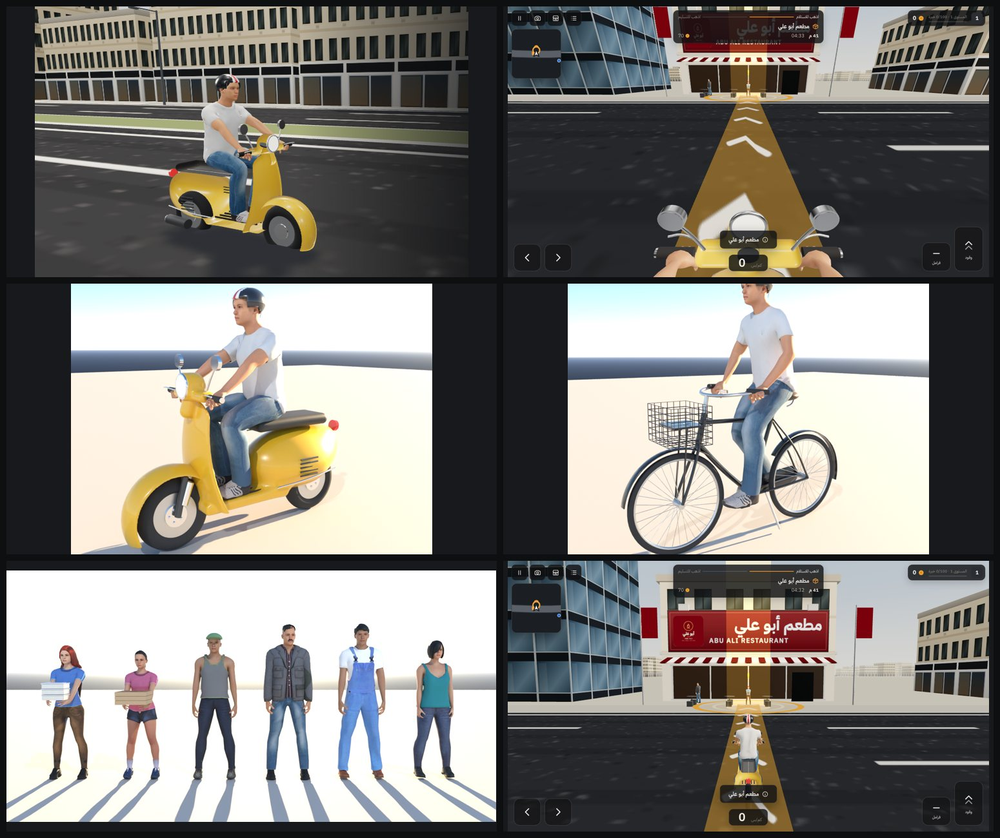

# Test results

Last run on 2026-10-14 (after the real buildings, day/night and weather, new vehicle physics, crashes, mirrors and road details) in the cloud build environment (Node 22, PostgreSQL 16, Chromium 1194 with a software GPU).

| Check | Command | Result |
|---|---|---|
| TypeScript | `npm run typecheck` | **pass** |
| API, rules, geometry and sun path | `npm test` | **32 / 32 passed** |
| Production build | `npm run build` | **pass** |
| Browser end-to-end | `npm run test:e2e` | **7 / 7 passed** |

## The living world, checked in the browser (`e2e/world.spec.ts`)

1. **Crash:** the scooter is set on a building wall at 45 km/h. After the impact it lies on its side, the engine is off and its speed is under 4 m/s (it does not pass through the wall). The "pick up the bike" button stands it up, the "start the engine" button restarts the engine, and "back to the road" puts it upright in a lane.
2. **Mirrors:** both scooter mirrors' render targets hold a real picture of the street behind (mean brightness and contrast checked pixel by pixel).
3. **Night and rain:** at 22:00 the street-lamp light pools, car lamps and lit windows are on and the sun is down. In heavy rain the rain is drawn, the road is fully wet, grip drops below 75 % and visibility (haze distance) drops under 260 m. After the rain stops the road dries over game time and grip returns.

Screenshots taken while driving at medium quality (software GPU) were reviewed for: Kurdistan (60 m) Street near the Iskan tunnel by day, at dusk, at night and in heavy rain, from the chase and the rider's views; the Empire World area; the old town south of the citadel. Problems found and fixed in this pass: rain puddles looked like white patches (now dark water with a sky sheen at grazing angles); lit windows shimmered into speckles at night (an interpolated per-building seed was amplified by the hash — now snapped exactly; window edges are also anti-aliased); mirrors showed mostly sky (re-aimed along the road); the headlight beam was too short.

## Performance: measured before and after (2026-10-14, quality pass)

Measured with `tools/perf/frame-time.mjs` at the same place (the game's start on Kurdistan Street before the Iskan tunnel), the same camera, 1280×720, medium quality, on the software GPU of the build environment (SwiftShader: no real GPU was available). Each part of a frame is timed after waiting for the GPU with a 1-pixel `readPixels`; median of several frames. An earlier figure of "4–6 s per frame" came from timing animation frames; the method here is exact, and gives the same order for the old version.

| View | Before (ae604f7) | After | Triangles drawn | Mirrors (both) |
|---|---|---|---|---|
| Rider, 13:00, clear | 4.83 s | 2.44–2.47 s | 2.63 M → 0.56 M | 0.84 → 0.17 s |
| Rider, 22:00, night | 5.04 s | 2.48 s | 2.63 M → 0.56 M | 0.85 → 0.18 s |
| Rider, 13:00, heavy rain | 5.24 s | 2.52 s | 2.63 M → 0.56 M | 0.89 → 0.18 s |
| Chase, 13:00, clear | 4.41 s | 2.48 s | 2.43 M → 0.56 M | 0.80 → 0.17 s |

What made the difference (found by removing one thing at a time and by counting triangles per object): the roof water tanks were 1.73 of the 2.63 million triangles in view, drawn out to the horizon though they cannot be seen from the street; far parked cars were drawn with the full model. Small detail now has a drawing distance (roof clutter ~170 m, parked cars full detail 150 m then simple blocks to 420 m, markings 240 m, trees 380 m, power lines 260–320 m), tanks use 8 sides, power cables are split into squares. The sky and the ground are drawn after the objects that cover them. Mirrors and traffic stay on: measured, they cost about 0.17 s and 0.1–0.15 s of the 2.4 s.

Where the remaining time goes on this software GPU (removing each in turn): it is mostly per-pixel work (a quarter of the pixels takes 0.96 s instead of 2.37 s); post-processing and 4× multisampling about 0.45 s, the city about 0.7 s (of which facade shading with window depth about 0.35 s), shadows about 0.25 s. On a real GPU these ratios differ; the triangle reduction applies to every device.

Loading: the larger files are now sent Brotli-compressed (`scripts/build-server.mjs` writes `.br`/`.gz` copies, the server serves them): the building data drops from 2.4 MB to 0.45 MB, 5.8 MB less in total.

The visual additions of this pass (window depth, Empire World's grid towers and main tower, the citadel gate, shop canopies, copings, wall air conditioners) are included in the "After" column.

## Covered by the API tests (`tests/api.test.ts`, `tests/geo.test.ts`)

- The seeded fictional dataset loads: at least 5 restaurants/cafés, 3 retail shops, 2 factories, 2 warehouses and an office. Packages, logos, and expired or scheduled sponsorships behave as expected.
- Admin routes refuse requests with no session, a wrong password, a missing anti-CSRF header, a foreign Origin, or a player cookie.
- Creating a business keeps the Arabic and English names; location, entrance and pickup persist separately; the business appears in `/api/world` and the world version is bumped.
- Locations outside the district and missing names are rejected.
- Logo upload and replacement work, and the old file is deleted. SVG, a fake PNG and oversized files are rejected.
- Edit, move (missions follow the new pickup point), disable (gone from the world and from missions; record kept), archive and restore all work, and each action is in the audit log.
- Categories can be added without code changes; duplicate slugs are refused.
- The mission lifecycle in order. Collecting or delivering from the wrong place, delivering before collecting, and impossible speed are all refused. The reward is paid once; a second claim returns 409. Three concurrent deliver requests pay once.
- Only one active mission per player; cancellation works. One player cannot touch another's run.
- Analytics records accepts and completions; demo events are labelled and can be excluded.
- Package edits reach the game. Category eligibility and location limits are enforced. Expiring a sponsorship never deletes the business.
- Demo reset requires `RESET` and `DEMO_MODE=true`, and restores the seed.
- Daily challenge rewards are paid once.
- The coordinate transform round-trips; local distances match great-circle distances (under 0.2 %); the road network is connected; routes follow streets.

## Covered by the browser tests (`e2e/`)

1. **Investor demo, end to end (desktop, Arabic):**
   - Sign in, then search "الستين" on the map.
   - Add a restaurant by clicking the map, with names, a logo upload and a menu item.
   - Create a mission to Abu Ali.
   - Open the game at the new business: its card shows the saved name and logo, and its 3D building exists.
   - Accept, collect at the pickup, deliver at Abu Ali, and receive 77 coins.
   - Rename and re-upload the logo in the dashboard; the running game picks up the new name.
   - Add a warehouse; it appears in the game as a warehouse.
   - Edit a package price.
   - Analytics shows real (non-demo) accepts and completions.
   - Disable the warehouse; it leaves the game.
   - Reset the demo.
2. **English interface:** the language switch flips the page to LTR. An anonymous admin write is refused (401).
3. **Phone (iPhone 13 emulation):** menu, tutorial, touch pedals, holding the throttle raises the speed, job board, no horizontal overflow.
4. **Dashboard on a phone:** sign in, map and editor visible, no horizontal overflow.

Notes on method:
- Driving across the district is replaced by the debug teleport (`?debug=1`): the software GPU renders a few frames per second. The server still checks that the player stands inside each pickup and drop-off zone.
- The game pages in the browser tests run at low graphics quality for the same reason.

## Visual review

Screenshots were taken and reviewed at 1280×720, 1366×820 and 1440×860 (desktop), iPhone 13 portrait and landscape, Pixel 7 portrait and Galaxy S9+ landscape, in both Arabic and English. Overlaps found during the redesign were fixed:
- AC units that covered the sign text
- a rotation hint that sat behind the nearby-business button
- a mobile menu button that showed on desktop

## 3D models (vehicles and people, third pass)

Checked after replacing the scooter, bicycle, riders and people:
- typecheck, the 29 API tests, the build and the 4 browser tests all pass again (results above are from this run)
- in the browser (Chromium, software GPU):
  - the GLB files load
  - the menu shows the yellow scooter and the bicycle, each with its rider
  - the chase view shows the rider from behind
  - the rider view shows the hands on the grips, the mirrors and the headlight
  - restaurant staff with foil trays and a "!" wait at the pickup
  - pedestrians stand outside businesses at medium and high quality
  - the dispatcher portrait appears in the dispatch dialog
- a security-policy bug found during this check was fixed: `connect-src` lacked `blob:`, which three.js needs to decode the textures inside the GLB files
- Blender (Cycles) previews of every model were reviewed for fit, clipping and texture errors. Fixed along the way:
  - logos left on the shirts
  - socks showing through the tight jeans
  - waistbands showing through two of the tops
  - hair showing through the cap
  - wheel origins
  - shared materials that mixed up skin and hair textures

## Fourth pass (original cast, cars, roads)

- typecheck, the 29 API tests, the build and the 4 browser tests pass (results above are from this run)
- The first browser run failed: the English-interface test timed out because the menu took about 96 s to load at medium quality. The cause was the parked cars. Each car type was instanced over every parking slot, with the other types' slots scaled to zero, so the scene drew about 1.4 million triangles. Parked cars are now instanced per type and per 160 m map cell, so each car is drawn once and off-screen streets are skipped.
- Menu load and frame time in the test browser (software GPU, 1366×820), before and after the fix:

| Quality | Before: load | Before: 2 frames | After: load | After: 2 frames | Previous release: load | Previous release: 2 frames |
|---|---|---|---|---|---|---|
| low | 9 s | 0.5 s | 10 s | 0.5 s | not measured | not measured |
| medium | 96 s | 8 s | 14 s | 1.3 s | 14 s | 1.4 s |
| high | over 150 s (menu never appeared) | not measured | 26 s | 2.9 s | not measured | not measured |

  These timings come from a CPU renderer, so they only show relative cost, not real-device frame rate.

## Baked street cars

- Street cars are now light meshes (3.2k triangles each) with the full models' detail baked into one 2048 px texture atlas (`tools/models/parked.py`)
- typecheck, the 29 API tests, the build and the 4 browser tests pass (results above are from this run)
- Checked in the game at medium quality from close up, from the side and from above:
  - lamps, grilles, wipers, door lines, plates and wheels show
  - each car keeps its own paint colour
  - glass reflects, chrome is metallic and tyres are matte
- Fixed along the way:
  - jagged dark notches at the bottom of the bumpers, which also affected the courier car
  - bright outlines around the windows, caused by filtering between mask values
- Medium quality in the test browser: the menu loads in 10 s (was 14 s), two frames take 0.9 s (was 1.3 s), and the scene draws about 380k triangles (was 450k)
- The offline cache version was raised, so returning players download the new car files
- Remaining: up close, the headlight edges are a little soft, because each car gets a 1024 px tile of the atlas

## Real Erbil map, traffic, driver's-seat view

- typecheck, the 29 API tests, the build and the 4 browser tests pass (results above are from this run). Two tests were adjusted for the real map:
  - deliveries are kilometres long now, so the challenge test leaves a plausible riding time
  - the route test uses the first and last landmark
- The phone test now checks the touch steering wheel, which phones get by default.
- Checked in the game (Chromium, software GPU):
  - the start on Sixty Meter Street before the Iskan tunnel
  - driving down the ramp into the tunnel (height goes from 0 to -6.2 m) and through it
  - traffic stopping at a red light, and the scooter stopping behind a car
  - the citadel, the Zanyari towers and Samad restaurant
  - the scooter and car first-person views, with their speedometers
- Medium quality in the test browser: the menu loads in about 13 s, two frames take 1.3–1.4 s, and the scene draws about 670k triangles. Buildings and props are drawn per map square, and parked cars were thinned out, to reach these numbers.

## Photographed materials, sky lighting and post-processing

- Added:
  - Poly Haven (CC0) asphalt, pavers, sand and plaster
  - a photographed sky that lights the scene (HDRI image-based lighting) and sets the sun direction and the haze colour
  - shadows at medium quality
  - post-processing: multisampling, colour grade and vignette, plus ambient occlusion (GTAO) and bloom at high quality
- typecheck, the 29 API tests, the build and the 4 browser tests pass
- Frame cost at medium quality in the test browser (software GPU, 1366×820), per frame:

| What is drawn | Time per frame |
|---|---|
| everything | 1.9 s |
| without shadows | 1.66 s |
| without shadows or post-processing | 1.42 s |
| before this change | about 0.7 s |

  Most of the increase comes from lit, normal-mapped ground instead of unlit ground. A software renderer exaggerates that; real phones have not been measured yet. Adaptive quality drops to low (unlit, no effects) when a device stays under 24 fps.

## Not tested

- Real iPhone and Android hardware (touch feel, GPU performance, Safari quirks), including frame rate with the new models and the pavement crowd
- The public deployment, since none exists yet
- OpenStreetMap tile loading and Nominatim search, which were blocked in the build environment
